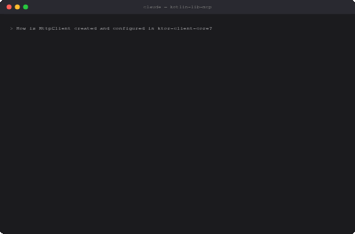
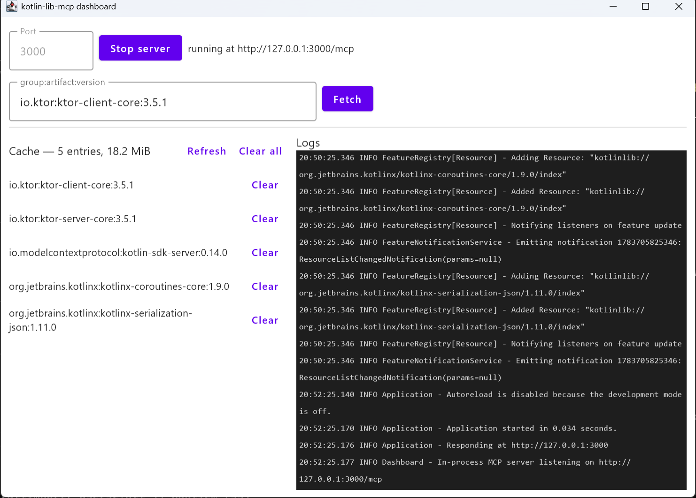

# kotlin-lib-mcp

[](https://github.com/aoreshkov/kotlin-lib-mcp/actions/workflows/ci.yml)
[](https://github.com/aoreshkov/kotlin-lib-mcp/actions/workflows/codeql.yml)
[](https://github.com/aoreshkov/kotlin-lib-mcp/releases/latest)
[](LICENSE)
[](https://kotlinlang.org)
[](https://github.com/mcp/aoreshkov/kotlin-lib-mcp)

Give your AI agent the **real sources** of any Maven-published Kotlin/Java library.

An [MCP](https://modelcontextprotocol.io) server that, on request, downloads the sources of a
library (e.g. `io.ktor:ktor-client-core:3.5.1`), parses them with the Kotlin **Analysis API**
(standalone K2/FIR mode), and exposes structured information — public API surface, KDoc,
dependencies/metadata, raw source + search — to MCP clients: Claude Code, Claude Desktop,
IntelliJ IDEA (AI Assistant / Junie), VS Code and GitHub Copilot. An optional Compose Desktop
dashboard runs the same server in-process.

**[Tools](#tools)** — `fetch_library` · `list_packages` · `list_declarations` ·
`get_api_signature` · `get_kdoc` · `get_source` · `search_source` · `diff_versions` · `diff_api` ·
`get_dependencies` · `list_versions` · `get_latest_version` — plus MCP resources and a prompt.

[](https://insiders.vscode.dev/redirect?url=vscode%3Amcp%2Finstall%3F%257B%2522name%2522%253A%2522kotlin-lib%2522%252C%2522command%2522%253A%2522docker%2522%252C%2522args%2522%253A%255B%2522run%2522%252C%2522-i%2522%252C%2522--rm%2522%252C%2522-v%2522%252C%2522kotlin-lib-mcp-cache%253A%252Fhome%252Fmcp%252F.cache%2522%252C%2522ghcr.io%252Faoreshkov%252Fkotlin-lib-mcp%2522%255D%257D)
[](https://insiders.vscode.dev/redirect?url=vscode-insiders%3Amcp%2Finstall%3F%257B%2522name%2522%253A%2522kotlin-lib%2522%252C%2522command%2522%253A%2522docker%2522%252C%2522args%2522%253A%255B%2522run%2522%252C%2522-i%2522%252C%2522--rm%2522%252C%2522-v%2522%252C%2522kotlin-lib-mcp-cache%253A%252Fhome%252Fmcp%252F.cache%2522%252C%2522ghcr.io%252Faoreshkov%252Fkotlin-lib-mcp%2522%255D%257D)

Those install the Docker image. For the Claude Code plugin (which runs on your JDK), IntelliJ IDEA,
or to run the release zip without Docker, see [Quick start](#quick-start-no-build-required).



<details><summary>Compose Desktop dashboard</summary>



</details>

## Why this and not a docs-lookup server?

Most documentation MCP servers scrape rendered doc sites or feed the model pre-digested
summaries. This one works from the **published sources jar** — the ground truth:

- **Resolved signatures, not regex guesses.** Declarations are analyzed with the same
  Analysis API that powers the Kotlin IDE, so `get_api_signature` returns real, type-resolved
  signatures (with graceful best-effort fallback when transitive dependencies are missing).
- **KMP-aware.** Kotlin Multiplatform libraries publish per-target sources jars; these are
  resolved properly via `.module` Gradle metadata, and every symbol is tagged with its targets.
- **KDoc as data.** Summaries, descriptions and tags are extracted per declaration — not
  whole HTML pages.
- **Exact version you asked for, offline after the first fetch.** Everything is cached on
  disk keyed by `group/artifact/version`; no re-downloads, no drift between the docs and the
  version you actually depend on.
- **Raw source when you need it.** `get_source` and bounded `search_source` let the agent
  read the actual implementation, not just the API.

## Quick start (no build required)

**Option 1 — Claude Code plugin.** The server plus skills that make Claude reach for it, two
commands (`/kotlin-lib:api`, `/kotlin-lib:migrate`) and a setup helper. Needs a JDK 25+ — the one on
your `PATH`, or any other set by path in the plugin's `java` option; no Docker. It downloads the
release zip on first use:

```
/plugin marketplace add aoreshkov/kotlin-lib-mcp
/plugin install kotlin-lib@kotlin-lib-mcp
```

See [`plugin/README.md`](plugin/README.md) for what it bundles.

**Option 2 — release zip.** Download the latest
[release](https://github.com/aoreshkov/kotlin-lib-mcp/releases/latest), unzip (needs a
Java 25+ runtime), then:

```sh
claude mcp add kotlin-lib -- /path/to/kotlin-lib-mcp-server-<version>/bin/server --transport stdio
```

**Option 3 — Docker.**

```sh
claude mcp add kotlin-lib -- docker run -i --rm -v kotlin-lib-mcp-cache:/home/mcp/.cache ghcr.io/aoreshkov/kotlin-lib-mcp
```

**Other clients.** IntelliJ IDEA, Android Studio, Junie, Claude Desktop and MCP registry installs are
covered in [`guide/clients.md`](guide/clients.md).

## Tools

All tools take a Maven `coordinate` (`group:artifact:version`). Call **`fetch_library`** first —
it downloads, extracts and analyzes the sources once; every other tool answers from the cached
index. `fetch_library`, `list_versions` and `get_latest_version` also accept `group:artifact`, and
`fetch_library` accepts `group:artifact:latest` to resolve the latest stable release.

| Tool | Purpose |
|---|---|
| `fetch_library` | Download + analyze + cache; returns a summary. Idempotent. Version may be omitted or `latest` |
| `list_packages` | Packages with declaration counts and KMP targets; paged |
| `list_declarations` | Declarations with signatures and deprecations; filter by `package`, `visibility` and `deprecated`; paged |
| `get_api_signature` | Resolved signature of one declaration by FQ name, with its deprecation and `ReplaceWith` |
| `get_kdoc` | KDoc (summary, description, tags) of one declaration |
| `get_source` | Raw source of a file (`path`) or one declaration (`fqName`); paged by line |
| `search_source` | Substring/regex search; bounded, returns `file:line` snippets |
| `diff_versions` | Unified diff between two fetched versions; summary-first, paged, `path`-filtered |
| `diff_api` | Public-API changes between two fetched versions — added, removed, changed, deprecated (with `ReplaceWith`); summary-first, paged, `package`- and `change`-filtered |
| `get_dependencies` | Dependency tree from `.pom`/`.module`; bounded `depth` and `maxNodes` |
| `list_versions` | Published versions from `maven-metadata.xml`, newest-first; paged |
| `get_latest_version` | Latest stable release (and newest overall) from `maven-metadata.xml` |

Every tool declares a title, behavior annotations, a typed `outputSchema` and an icon, and returns
compact JSON text with matching `structuredContent`. Symbols whose types can't be resolved (missing
transitive dependencies) degrade to `bestEffort: true` PSI signatures instead of failing.

## Going further

- [Clients](guide/clients.md): IntelliJ IDEA, Android Studio, Junie, `.mcp.json`, MCP registries
- [Configuration](guide/configuration.md): Streamable HTTP, command-line flags, cache location
- [Protocol features](guide/protocol.md): tool metadata, elicitation, tasks, resources, prompt, icons
- [Telemetry](guide/telemetry.md): OpenTelemetry traces with `--otel`

## Privacy

**Nothing about you is collected, stored remotely, or shared.** There is no analytics, no
phone-home, no account, and no credential of any kind.

- **What leaves your machine.** Only requests to the Maven repositories you point it at (Maven
  Central, plus any `--repo`; `--no-maven-central` drops Central): the `maven-metadata.xml`,
  `.pom`/`.module` metadata and sources jar for the coordinates you ask about. Those repositories see the coordinate and your IP,
  under their own privacy policies. Pulling the Docker image likewise talks to GHCR, and the Claude
  Code plugin's launcher talks to this repository's GitHub releases (the releases API at most once
  a day, and a download when there is a new server). That is the complete list of outbound traffic.
- **What it reads.** Downloaded library sources only. It does not read, index or transmit your
  project's code — it has no access to it.
- **What it stores, and where.** Downloaded artifacts and the parsed index, on your disk only,
  under the OS cache directory (see [Cache](guide/configuration.md#cache)) or `--cache-dir`. Under `--tasks`, task
  records live in a `tasks/` subdirectory. Nothing is written anywhere else.
- **Retention.** Cached libraries stay until you delete them — the directory is browsable and safe
  to remove at any time. Task records are dropped once their TTL elapses (10 minutes by default,
  1 hour maximum).
- **Logs.** stderr on your machine. `--forward-logs-to-client` (opt-in) mirrors them to your MCP
  client; `--otel` (opt-in) exports trace spans to the OTLP collector *you* configure, and carries
  no personal data — method names, tool names, session id, transport. Both are off by default.
- **Contact.** Questions: [open an issue](https://github.com/aoreshkov/kotlin-lib-mcp/issues).
  Security or privacy reports: [private vulnerability reporting](SECURITY.md).

## Contributing

Contributions welcome: [CONTRIBUTING.md](CONTRIBUTING.md) also covers building from source. Release
history lives in [CHANGELOG.md](CHANGELOG.md), help is described in [SUPPORT.md](SUPPORT.md), and
security reports go through [private vulnerability reporting](SECURITY.md).

## Sponsor

If `kotlin-lib-mcp` saves you time, consider
[sponsoring its maintenance](https://github.com/sponsors/aoreshkov). Sponsorship funds
keeping the Analysis API version-lock current with new Kotlin releases and the
supply-chain-hardened release pipeline. Every tier is appreciated.

## License

[Apache-2.0](LICENSE)
